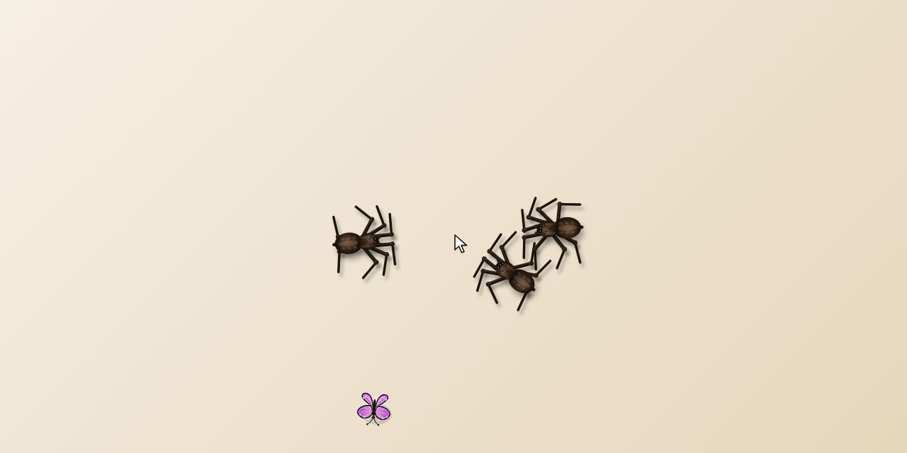
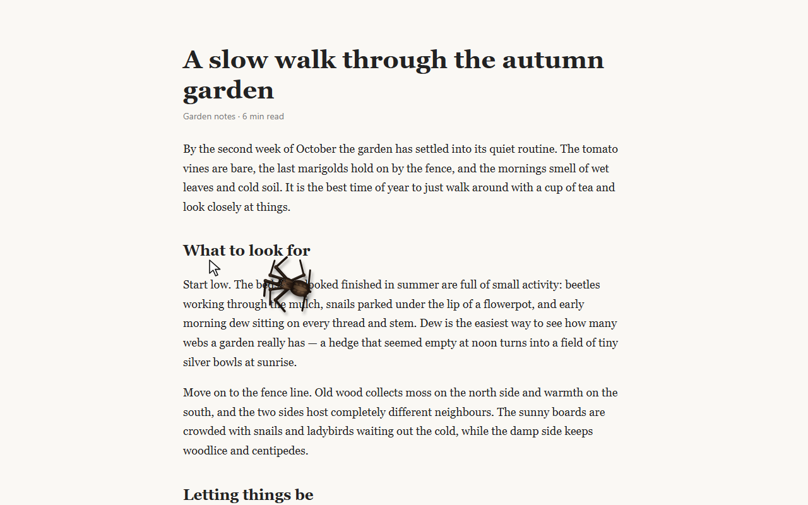
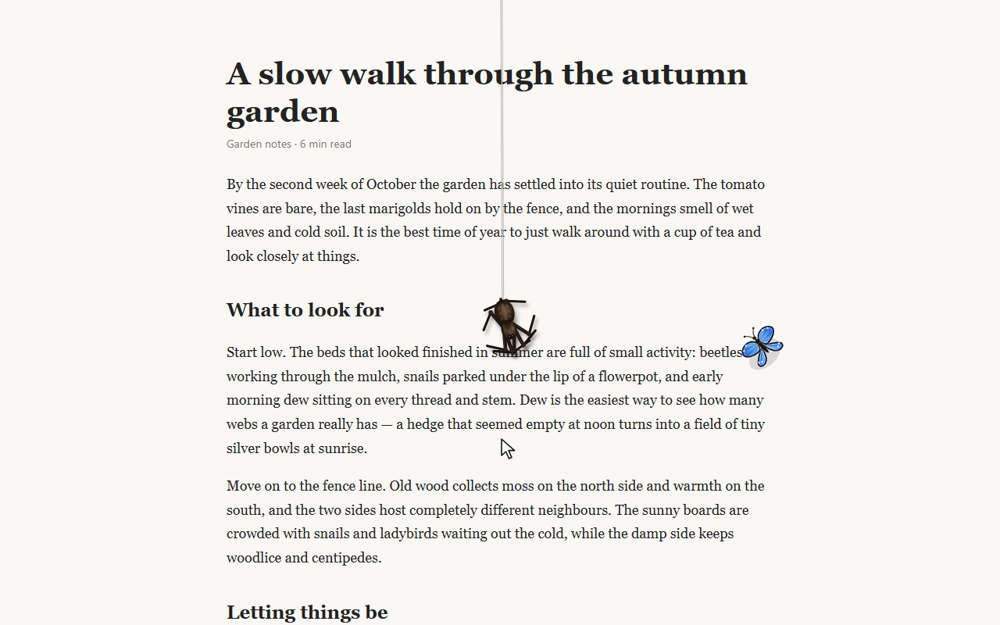
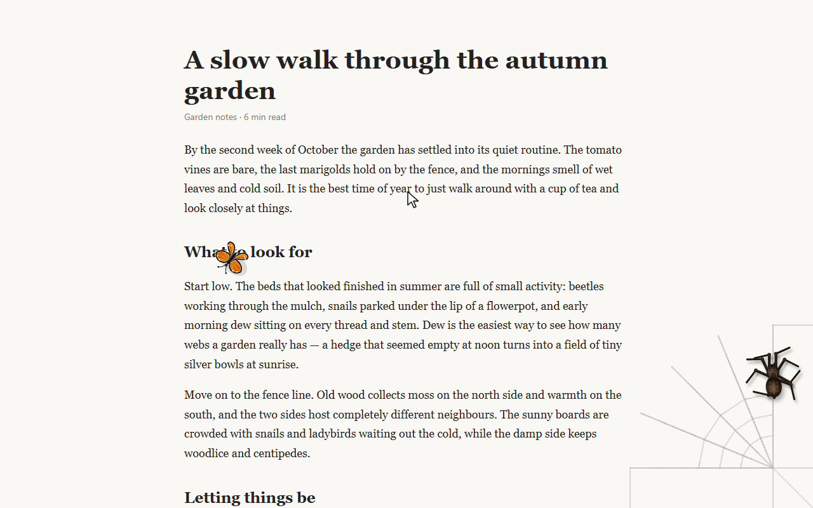
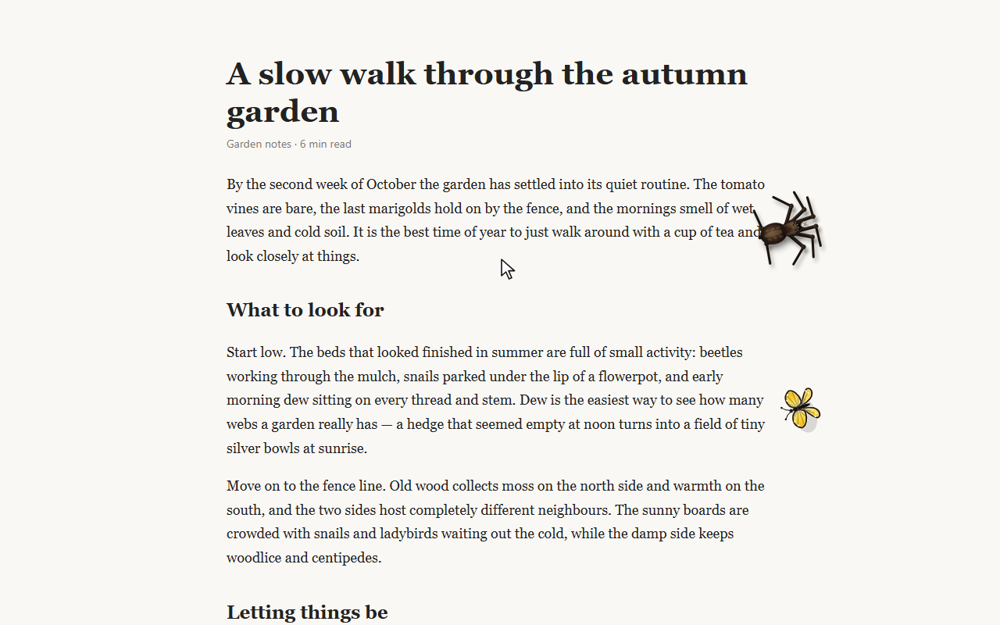
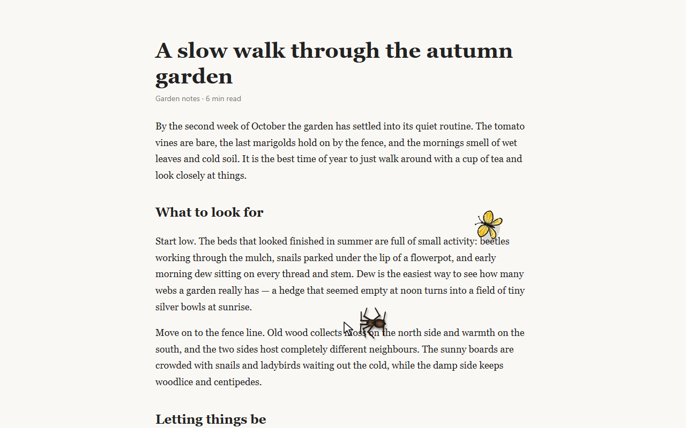
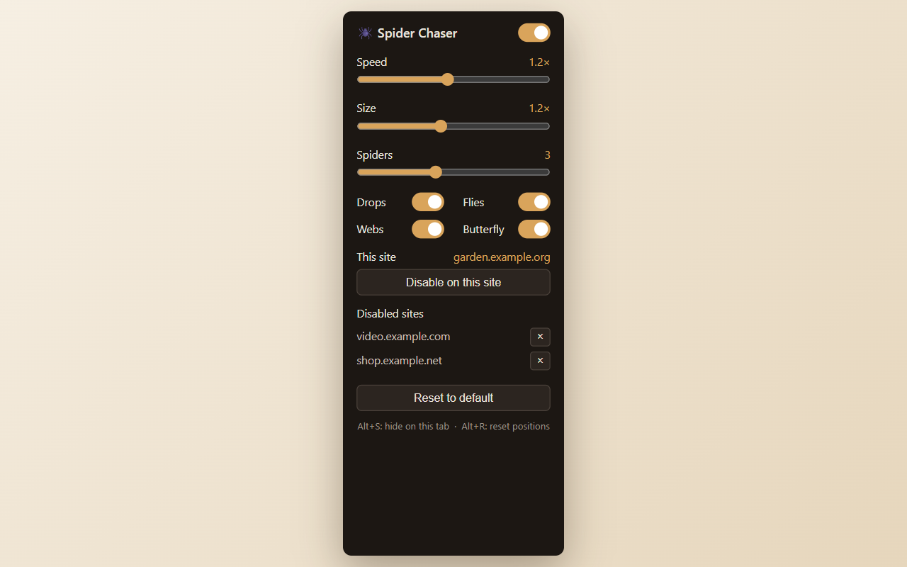

# 🕷️ Spider Chaser

A Chrome extension (Manifest V3) that puts realistic, living spiders on every web page.

They walk on eight legs with a real alternating gait (four legs lift while four stay planted),
stalk your mouse cursor in short bursts, and do a lot more:

- **Stalk, pounce, watch** — they creep after the cursor, pause, dash, and stop to watch it (their eyes follow it)
- **Run away** — flick the mouse fast near them, or click close to them
- **Web drops** — climb off the top of the screen and lower themselves back down on a silk thread, swinging and spinning
- **Hunt flies** — a fly lands, the spider ambushes it (the fly may escape), then eats it wrapped in silk
- **Weave webs** — walk to a screen corner and weave a web strand by strand: spokes first, then the rings
- **Wander** — roam around by themselves when the cursor leaves the window
- **A butterfly** — a colourful butterfly (monarch, blue, yellow or purple) flutters around the page on its own, glides, lands and slowly opens and closes its wings, keeps away from the spiders, and leaves after a while

Spiders never block clicks and never touch the page content — they are drawn on a small canvas overlay.



| | |
|---|---|
|  |  |
|  |  |
|  |  |

_(Screenshots are generated with real headless Chrome by `test/shoot.js` — locally, or with the **Screenshots** GitHub Action; see Development.)_

## Install (from source)

Or grab `spider-chaser-1.7.0.zip` from the [Releases](https://github.com/juyel-dev/spider-chaser/releases) page, unzip it, and load that folder the same way (steps 2–4 below).

1. Download or clone this repository
2. Open `chrome://extensions` and turn on **Developer mode**
3. Click **Load unpacked** and choose the `spider-chaser/` folder
4. Refresh any open page

## Settings (toolbar icon)

Speed · Size · Number of spiders (1–6) · Web drops / Flies / Webs / Butterfly on-off · "Disable on this site" with a list of disabled sites.

Keyboard: `Alt+S` hides the spiders on the current tab, `Alt+R` resets their positions.

## Development

```
spider-chaser/   the extension (manifest.json, content.js, popup.*, icons/)
test/sim.js      headless smoke test — runs content.js against a fake page for 10 simulated minutes
test/shoot.js    takes the screenshots with real headless Chrome (test/demo/ is the demo page)
.github/         CI (syntax + simulation) and the Screenshots workflow
publish/         store listing text, privacy policy, build-zip.cmd
```

Run the smoke test (needs Node.js):

```
node test/sim.js
```

## Privacy

The extension collects nothing, makes no network requests and has no analytics or ads.
Settings are stored only in your browser. See [publish/PRIVACY.md](publish/PRIVACY.md).

## License

[MIT](LICENSE) © 2026 Juyel Hossain
